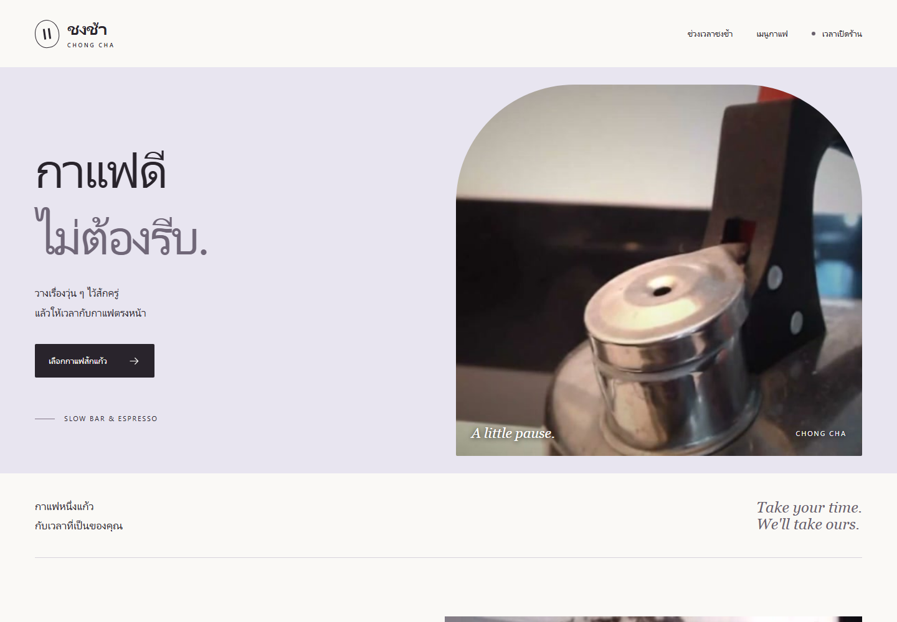
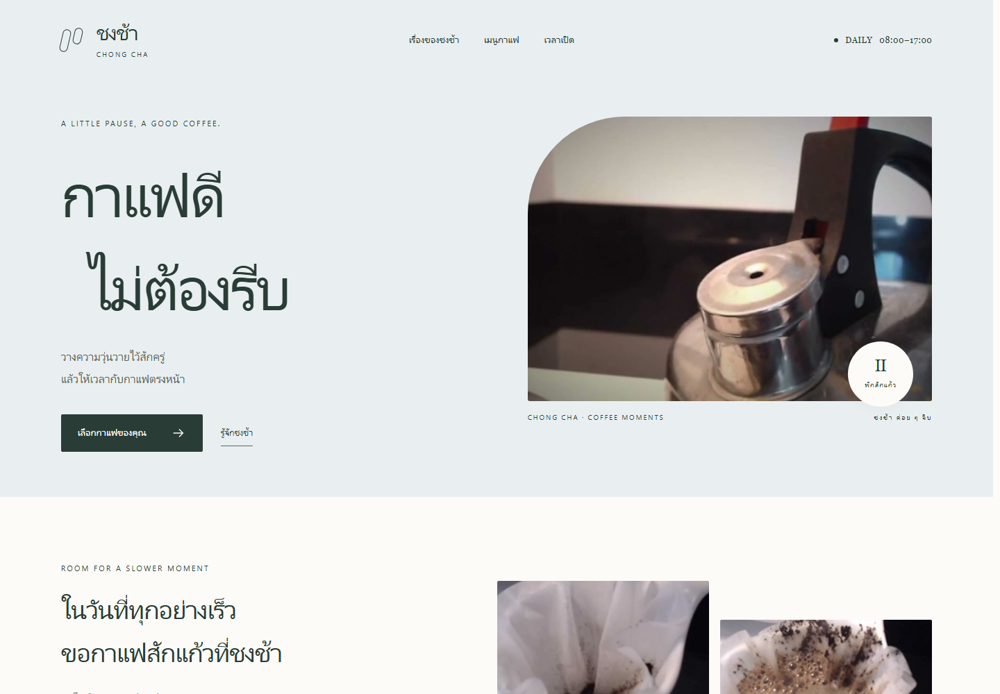

# Creative Taste

**สกิลช่วยให้ Codex และ ZCode ตัดสินใจด้านงานสร้างสรรค์อย่างมีทิศทาง พร้อมผลงาน Before / After ที่เปิดตรวจได้จริง**

Frontend · Music · Motion graphics · Video

สกิลนี้ช่วยเชื่อม brief, reference และรายละเอียดการผลิตเข้าด้วยกัน เลือกสิ่งที่ควรเด่น สิ่งที่ควรสนับสนุน และสิ่งที่ควรลด แล้วตรวจจากชิ้นงานที่ render จริง ไม่ได้กำหนดให้ทุกงานใช้ aesthetic หรือเครื่องมือแบบเดียวกัน

## ดูผลงานก่อนเชื่อคำอธิบาย

เปิด **[หน้ารวม Demo A/B](demos/index.html)** จาก clone/download ในเครื่อง เลือกผลงานที่ชอบก่อนเปิดเฉลย ทั้งสองฝั่งได้ brief และ assets เดียวกัน Before ทำงานตามปกติเต็มความสามารถ ส่วน After เพิ่ม `creative-taste` ในบริบทใหม่ ไม่มีการลดคุณภาพ Before และไม่มีผู้ชนะอัตโนมัติ

| สื่อ | Before | After | Brief |
|---|---|---|---|
| Frontend | [หน้าเว็บ](demos/frontend/before/index.html) · [desktop](demos/frontend/before/desktop.png) · [mobile](demos/frontend/before/mobile.png) | [หน้าเว็บ](demos/frontend/after/index.html) · [desktop](demos/frontend/after/desktop.png) · [mobile](demos/frontend/after/mobile.png) | [โจทย์](evaluation/briefs/frontend.md) |
| Music | [เพลง](demos/music/before/music.wav) · [พร้อมบรรยาย](demos/music/before/mix.wav) | [เพลง](demos/music/after/music.wav) · [พร้อมบรรยาย](demos/music/after/mix.wav) | [โจทย์](evaluation/briefs/music.md) |
| Motion | [วิดีโอ 8 วินาที](demos/motion/before/video.mp4) | [วิดีโอ 8 วินาที](demos/motion/after/video.mp4) | [โจทย์](evaluation/briefs/motion.md) |
| Video | [คลิป 20 วินาที](demos/video/before/video.mp4) | [คลิป 20 วินาที](demos/video/after/video.mp4) | [โจทย์](evaluation/briefs/video.md) |




GitHub แสดง source ของ HTML จึงต้องดาวน์โหลดหรือ clone เพื่อเปิดหน้าเว็บจริง เปิด `demos/index.html` ได้โดยตรง ไม่ต้องติดตั้ง dependency ของ frontend และไม่ต้องมี backend ถ้าต้องการเสิร์ฟผ่าน localhost:

```sh
python -m http.server 8765
```

แล้วเปิด `http://localhost:8765/demos/` ขณะอยู่ที่ราก repo นี้ เสียงบรรยายสังเคราะห์ชุดเดียวกันใช้ทดสอบพื้นที่สำหรับเสียงพูด ไม่ใช่เสียงเจ้าของงานหรือมาตรฐานการพากย์ที่เจ้าของอนุมัติ

## ติดตั้งให้ Codex และ ZCode

ต้องมี Python 3.11+ เฉพาะสำหรับตัวช่วยติดตั้ง สกิลเองเป็น Markdown ไม่มี runtime dependency

```sh
git clone https://github.com/beukkung/creative-taste.git
cd creative-taste
python scripts/install.py
python scripts/install.py --check
```

ค่าเริ่มต้นคัดลอกเฉพาะสกิลไปยัง `~/.agents/skills/creative-taste` ซึ่งเป็นตำแหน่งร่วมของทั้งสอง runtime ในรุ่นที่ตรวจ ตัวช่วยจะไม่เขียนทับไฟล์ที่แตกต่าง ไม่เปลี่ยน AGENTS.md, MCP, โมเดล หรือสกิลเดิม การอัปเดตให้ถอนสำเนาที่ตรงกับต้นฉบับรุ่นเดิมก่อน หรือสำรองสำเนาที่แก้เองไว้ด้วยตนเอง

เปิด session ใหม่แล้วเรียก `$creative-taste` สำหรับ ZCode ใช้ `/skill creative-taste` เพื่อบังคับโหลดได้ด้วย หากรุ่นของคุณไม่ค้นพบตำแหน่งร่วม ใช้ Settings → Skills → Import หรือเลือกติดตั้งเฉพาะ runtime:

```sh
python scripts/install.py --client codex
python scripts/install.py --client zcode
```

เลือกวิธีเดียวเมื่อ runtime รองรับตำแหน่งร่วม เพื่อไม่ให้ชื่อสกิลซ้ำ ผลตรวจจริงและเวอร์ชันอยู่ใน [runtime verification](evaluation/RUNTIME.md) การตรวจรูปแบบไฟล์ไม่ถือว่าโหลดใน session ผ่านแล้ว

- **Codex:** ยืนยัน session ใหม่อ่านสกิลที่ติดตั้งและคู่มือ video ผ่านแล้ว
- **ZCode CLI 0.16.9:** ยืนยันค้นพบสกิลจากตำแหน่งร่วม แต่การเริ่ม prompt ติด `Model creation failed` จึงยังไม่อ้างว่า model activation หรือการผลิตงานใน ZCode ผ่านแล้ว

ถอนตำแหน่งร่วมด้วย `python scripts/install.py --uninstall` หรือเติม `--client codex` / `--client zcode` ให้ตรงกับที่ติดตั้ง คำสั่งจะปฏิเสธการลบถ้าไฟล์เปลี่ยนหรือมีไฟล์เพิ่ม เพื่อรักษางานที่คุณแก้เอง

## ตัวอย่างใช้กับงานจริง

```text
$creative-taste ทำ landing page ภาษาไทยให้ร้านนี้ ใช้ภาพที่แนบ
เป้าหมายคือให้คนอ่านเมนูได้ง่ายบนมือถือ รักษาสีแบรนด์เดิม
```

```text
$creative-taste แต่ง instrumental 20 วินาทีรองเสียงบรรยายนี้
อบอุ่นแต่ไม่ง่วง ขอ motif ที่จำได้และไม่แย่งคำพูด
```

```text
$creative-taste ทำ kinetic typography จากข้อความนี้ 8 วินาที
คนดูปิดเสียง ต้องอ่านทัน และเก็บ source ที่ render ซ้ำได้
```

```text
$creative-taste ตัด footage ชุดนี้เป็นคลิปแนวตั้ง 20 วินาที
ตรวจสิ่งที่เกิดในภาพก่อนเลือก shot ไม่เพิ่มข้อมูลสถานที่เอง
```

ใช้ร่วมกับสกิลผลิตงานที่มีอยู่ได้ เช่น frontend, Remotion, CapCut หรือ DAW ไม่ต้องโหลดทุกคู่มือพร้อมกัน และไม่ต้องใช้ REA ทุกครั้ง งาน backend หรือการแก้เชิงกลที่ไม่เกี่ยวกับ craft ไม่ควรดึงสกิลนี้เข้ามาเพิ่มงาน

## REA เกี่ยวข้องอย่างไร

นำวิธีตามหลักฐานของ [REA](https://github.com/morluto/rea) มาใช้: ระบุสิ่งที่สังเกตได้ แยกสิ่งที่อนุมาน แล้วทดสอบผลลัพธ์ ใช้ REA จริงเมื่อโจทย์ต้องตรวจ shipped app/runtime ที่ source หรือ media ไม่ได้อธิบาย อ่าน [คู่มือเลือกหลักฐาน](skills/creative-taste/references/reference-analysis.md) ก่อนเลือกเครื่องมือ

REA ไม่ใช่การเข้าถึง weights หรือ hidden reasoning ของโมเดล และ repo นี้ไม่อ้างว่าแกะรสนิยมภายในของ Claude หรือมีคุณภาพเทียบเท่าโมเดลอื่นจากการทดลองสี่คู่

## ตรวจและสร้างผลงานซ้ำ

```sh
python scripts/test_install.py
python scripts/verify.py
```

แต่ละ demo เก็บ source ในโฟลเดอร์ของตัวเอง: frontend ใช้ `index.html`, music ใช้ `compose.py`, motion/video ใช้ `source.py` การ render เสียง/วิดีโอใหม่ใช้ Python, NumPy, FFmpeg และสำหรับข้อความไทยใช้ Pillow + uharfbuzz + freetype-py กับฟอนต์ Tahoma/Leelawadee ของ Windows เครื่องที่ไม่มีฟอนต์ดังกล่าวต้องเปลี่ยนไปใช้ฟอนต์ไทยที่ตนมีสิทธิ์ใช้ ไม่มีการแจก system fonts

การสร้างซ้ำเพื่อทดสอบให้คัดลอกโครงสร้าง `demos/` ไปที่ scratch directory ก่อน แล้วเรียก source ในสำเนา เพื่อไม่ให้ generator เขียนทับหลักฐาน run เดิม เสียงกลางสร้างได้ด้วย `scripts/make_narration.py` และ `espeakng-loader==0.2.4` ซึ่งเป็น dependency เฉพาะการสร้าง narration ใหม่ ไม่ใช่ dependency ของสกิล ดู [reproducibility report](evaluation/reproducibility.json) และ [narration provenance](evaluation/narration-provenance.json) สำหรับการทดสอบที่ทำจริง

อ่าน [protocol](evaluation/PROTOCOL.md), [baseline observations](evaluation/BASELINE.md), [ผลตรวจ](evaluation/RESULTS.md), [holdouts](evaluation/holdouts.md) และ [run logs](evaluation/runs/summary.json) เพื่อแยกสิ่งที่พิสูจน์แล้วจากความชอบ เก็บเวลาและข้อจำกัดตามจริง ไม่ใช้คะแนนของ agent เป็นคำตัดสินแทนเจ้าของงาน

## License และเครดิต

สกิล, source code, เพลงและเสียงบรรยายที่สังเคราะห์ใหม่ในเครื่อง: **[MIT](LICENSE)** · Coffee footage/frames และวิดีโอที่ดัดแปลง: **CC BY-SA 4.0** ดู [สิทธิ์และเครดิตทั้งหมด](ASSET-LICENSES.md) เครื่องมือ eSpeak NG ไม่ได้แนบใน repo

แหล่งเอกสาร runtime: [Codex skills](https://developers.openai.com/codex/skills/) · [ZCode skills](https://zcode.z.ai/en/docs/skill)
